# Vault Sync

Back up your Obsidian vault to **your own Cloudflare account**, keep every version of every file, sync it across devices, and read it from any browser.

[](https://deploy.workers.cloudflare.com/?url=https://github.com/Kenth06/vault-sync)

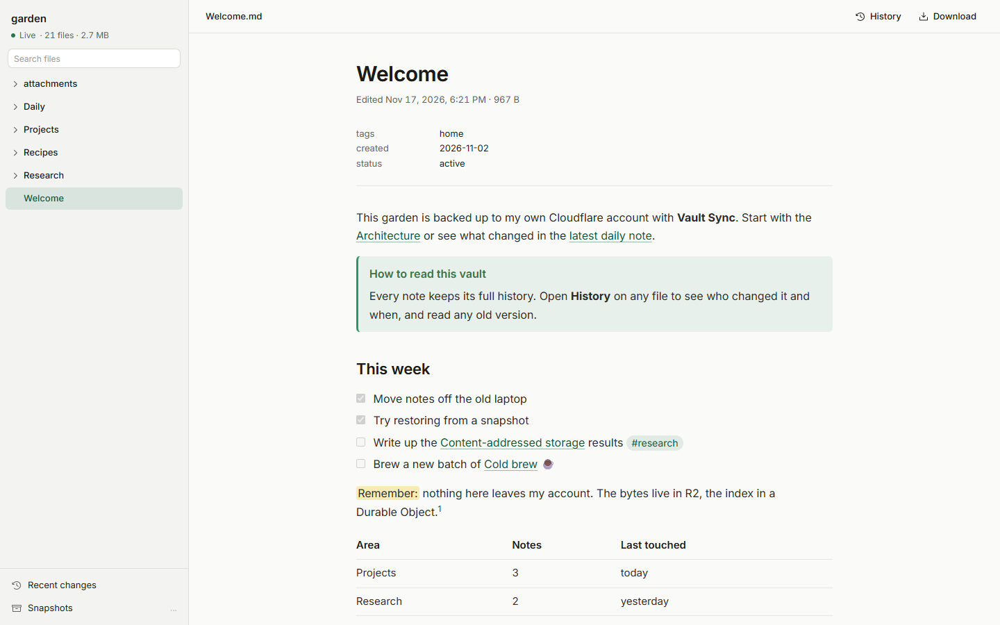

Your notes never pass through anyone else's servers. One Cloudflare Worker stores the bytes in R2, addressed by their SHA-256, and the vault index with the full history in a SQLite Durable Object. A daemon or the Obsidian plugin pushes every save within seconds; other devices pull it live.

## What you get

- **Continuous backup** of the whole vault: notes, attachments, settings, `.canvas` boards.
- **Every version of every file**, who saved it and when, readable in the browser and recoverable from the CLI.
- **Daily snapshots** of the whole vault, browsable file by file and restorable into a folder.
- **Sync across devices**, live over a WebSocket. Concurrent offline edits keep both versions.
- **A read-only web viewer** that renders your vault the way Obsidian does.
- **One Worker, three Cloudflare primitives** (Workers, Durable Objects, R2). Nothing else to run.

## The viewer

Sign in with your vault id and admin secret from any browser. The viewer renders Obsidian's own syntax and file types:

|                                                                                                   |                                                                              |
| ------------------------------------------------------------------------------------------------- | ---------------------------------------------------------------------------- |
| 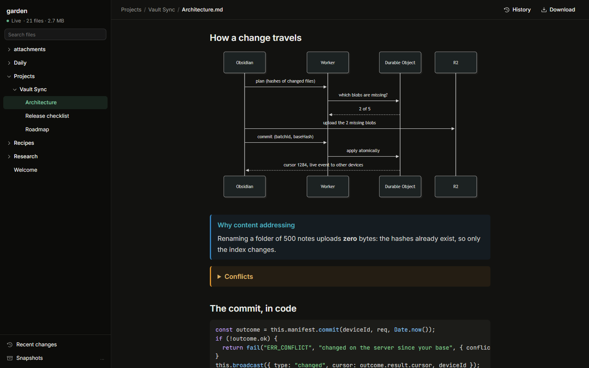      | 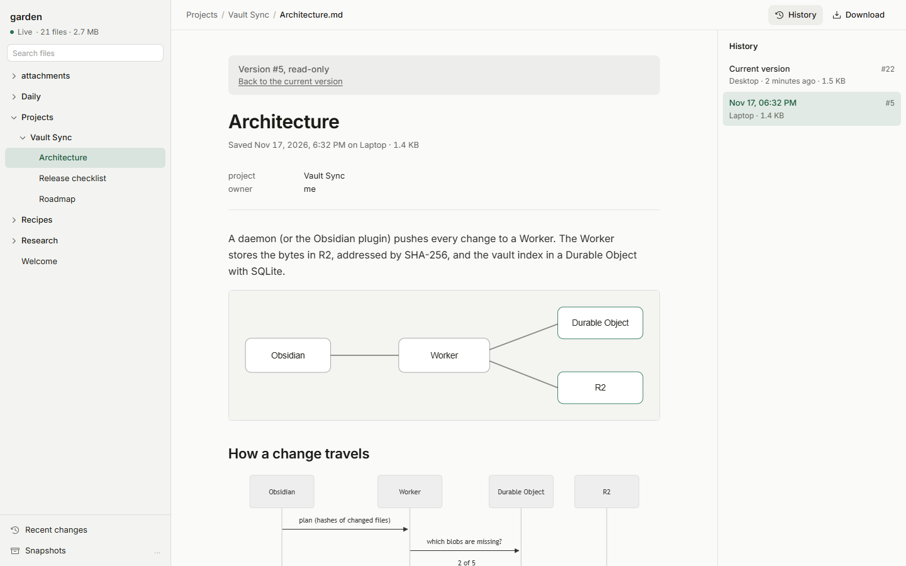 |
| Mermaid diagrams, callouts and highlighted code                                                   | History of every file, with any old version                                  |
| 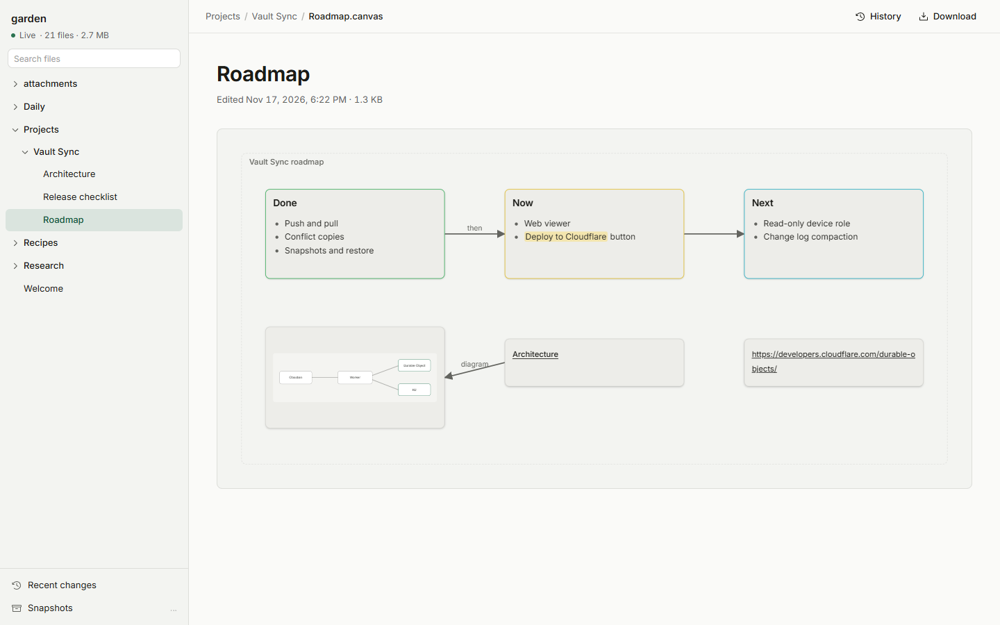 | 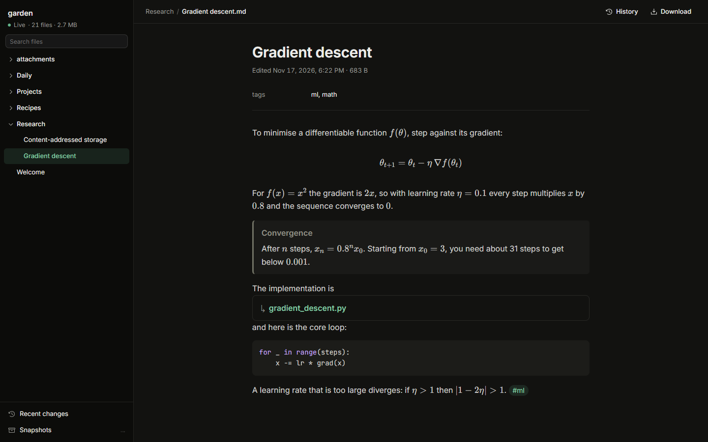    |
| `.canvas` boards                                                                                  | Math with KaTeX                                                              |
| 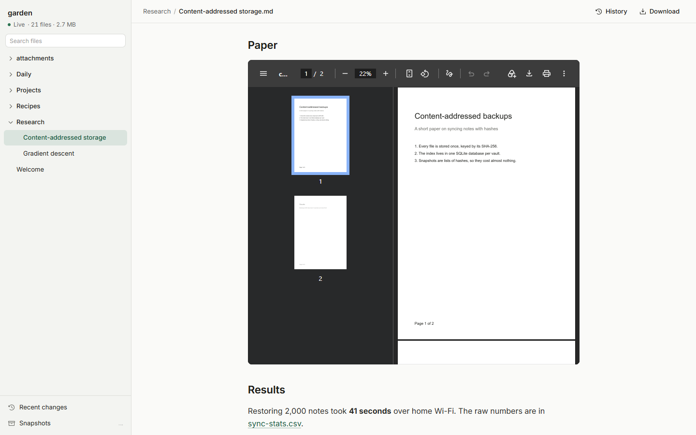                                                     | 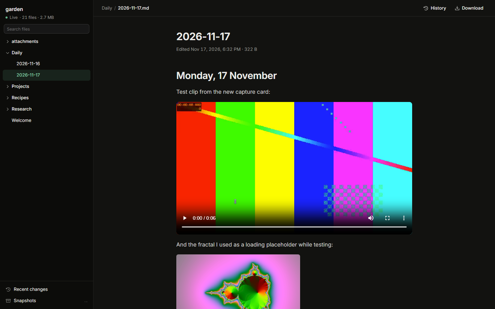        |
| PDFs                                                                                              | Video, audio and GIFs, with seeking                                          |
| 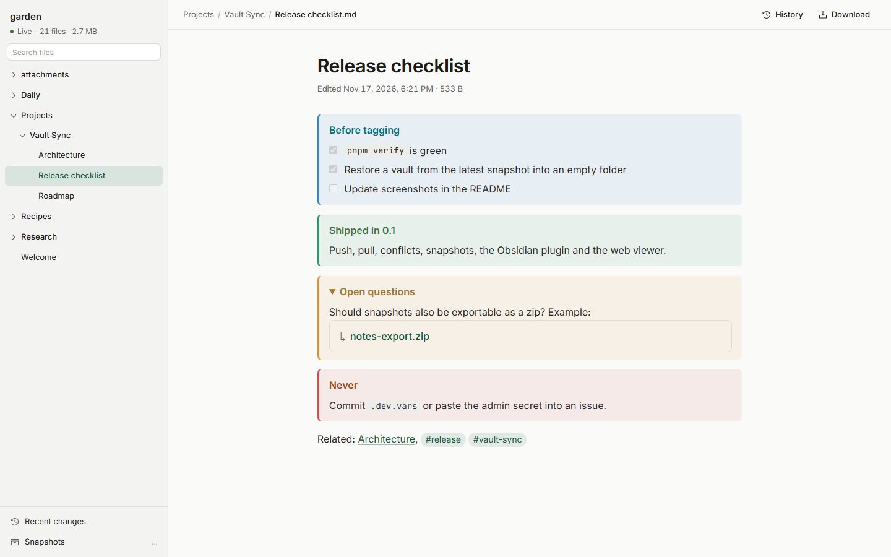             | 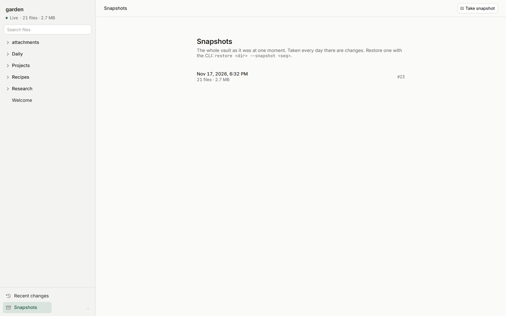                       |
| Callouts, tasks, tags, file embeds                                                                | Snapshots                                                                    |

<p>
  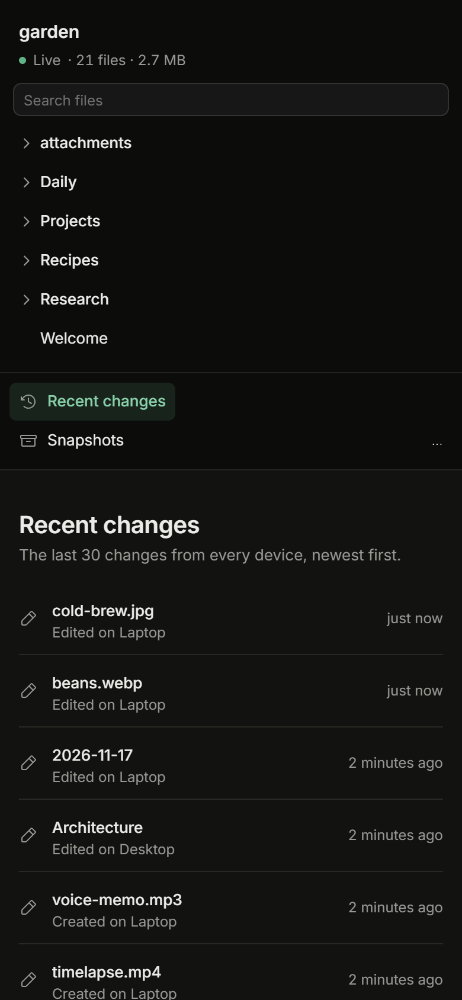
  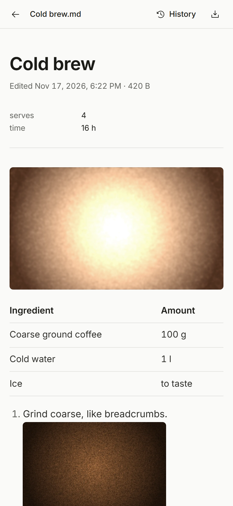
</p>

Supported: properties, wikilinks with aliases and `#headings`, `![[embeds]]` with sizes (`|300`), callouts (including collapsible `+`/`-`), `==highlights==`, `#tags`, `%%comments%%`, task lists, tables, footnotes, `$math$`, Mermaid, highlighted code, and PNG, JPG, GIF, WebP, AVIF, SVG, PDF, MP3, WAV, M4A, OGG, MP4, WebM, MOV and `.canvas` files. Anything else can be downloaded.

The viewer is read-only. Its browser session holds a device token in an HttpOnly cookie, and the Worker only forwards read routes and snapshot creation for it. **Sign out of this browser** revokes that device.

## 1. Deploy

**One click:** press **Deploy to Cloudflare** above. Cloudflare copies this repository to your GitHub account, creates the R2 bucket and the Durable Object, asks you for `ADMIN_SECRET`, builds and deploys. Your app lives at `https://vault-sync.<your-subdomain>.workers.dev`.

**From your machine:**

```sh
pnpm install
pnpm exec wrangler secret put ADMIN_SECRET   # a long random string, e.g. openssl rand -base64 32
pnpm deploy
```

The admin secret only enrolls devices; each device then gets its own revocable token. Keep it in a password manager.

You need the Workers Paid plan (USD 5/month) for Durable Objects at a useful size. A personal vault costs a few cents a month on top of that; see [docs/costs.md](docs/costs.md) to set spend limits and alerts.

## 2. Back up a vault

**With the Obsidian plugin** (tested on Obsidian desktop; it is not marked desktop-only, but mobile is untested):

```sh
pnpm --filter @vault-sync/obsidian-plugin build
```

Copy `apps/obsidian-plugin/dist/main.js` and `apps/obsidian-plugin/manifest.json` into `<vault>/.obsidian/plugins/vault-sync-cloudflare/`, then in Obsidian enable **Vault Sync (Cloudflare)** under Settings → Community plugins, enter your Worker URL and a vault id, and press **Connect…**. The first sync uploads the whole vault. Requires Obsidian 1.11.4 or later.

**With the CLI** (a background daemon, no Obsidian needed; Node 24 or later):

```sh
cd apps/cli
node src/main.ts init "<vault-dir>" --url https://vault-sync.<your-subdomain>.workers.dev --vault-id my-vault
node src/main.ts watch "<vault-dir>"
```

Use one of the two per vault on a given device, not both. Under `.obsidian/` only your settings, `plugins/` and `snippets/` are synced, never workspace layout or caches; `.git/` and `.trash/` are skipped. Add your own gitignore-style rules to `.vaultsyncignore` at the vault root before the first sync.

## 3. Add another device

Install the plugin or run `init` on the other device with the same URL and vault id. It downloads the vault and both stay in sync. If the same note changes on two devices while one is offline, the server version keeps the original name and the other is saved next to it as `<name> (conflict <device> <date>).md`.

## 4. Recover files

| Situation                     | How                                                                       |
| ----------------------------- | ------------------------------------------------------------------------- |
| An older version of one note  | **History** in the viewer, or `log "<path>" --version <seq> --out <file>` |
| The whole vault at a snapshot | `restore <empty-dir> --url <worker-url> --vault-id <id> --snapshot <seq>` |
| The whole vault at any change | `restore <empty-dir> --url <worker-url> --vault-id <id> --at <seq>`       |

`restore` writes into an empty folder and keeps the original modification times. The server keeps 30 daily and 12 monthly snapshots; file contents that no snapshot or recent history needs are deleted after a week.

## CLI reference

Run from `apps/cli` as `node src/main.ts <command>`. `[dir]` defaults to the current directory. `VAULTSYNC_ADMIN_SECRET` skips the admin secret prompt.

| Command                                     | What it does                                                             |
| ------------------------------------------- | ------------------------------------------------------------------------ |
| `init <dir> --url <url> --vault-id <id>`    | Enroll this device and link a vault; `--name` sets the device name       |
| `watch [dir]`                               | Sync continuously, with live updates from other devices                  |
| `sync [dir]`                                | Pull remote changes, then push local ones, once                          |
| `push [dir]` / `pull [dir]`                 | One direction only                                                       |
| `status [dir]`                              | Local and remote cursor, last sync, last error                           |
| `log <path> [dir]`                          | Versions of a file; `--version <seq> [--out <file>]` recovers one        |
| `snapshots [dir]`                           | List snapshots; `--create` takes one now                                 |
| `restore <dir> --url --vault-id`            | Rebuild a vault into an empty folder; `--at <seq>` or `--snapshot <seq>` |
| `devices [dir]` / `revoke <deviceId> [dir]` | List the vault's devices / revoke one immediately (admin secret)         |

## How it works

```txt
 Obsidian plugin / CLI ──▶ /v1  ┐
                                ├─ one Worker ──▶ Durable Object per vault (index, history, devices)
 Browser (viewer) ─────▶ /api  ┘              └─▶ R2 (file bytes by SHA-256, snapshots)
```

A sync asks the Worker which file hashes it is missing, uploads only those to R2, then commits the batch atomically; a commit is rejected if the server changed a file since the device last saw it. Renaming a folder uploads nothing. Live updates use hibernatable WebSockets, so an idle connection costs nothing.

| Path                   | What it is                                                                     |
| ---------------------- | ------------------------------------------------------------------------------ |
| `apps/api`             | The device API: Hono, one SQLite Durable Object per vault, R2                  |
| `apps/web`             | The viewer (React, Vite, Kumo) and the Worker entry that serves API and viewer |
| `apps/cli`             | The `vaultsync` daemon                                                         |
| `apps/obsidian-plugin` | The Obsidian plugin                                                            |
| `packages/sync-core`   | The sync engine shared by the CLI and the plugin                               |
| `packages/protocol`    | Zod schemas for every request and response                                     |

Design records: [docs/decisions.md](docs/decisions.md). Security model and how to report a vulnerability: [SECURITY.md](SECURITY.md).

## Development

```sh
pnpm install
cp .dev.vars.example .dev.vars   # set ADMIN_SECRET
pnpm dev:worker                  # the whole app on http://127.0.0.1:8787
```

Point the CLI or the plugin at `http://127.0.0.1:8787`.

```sh
pnpm verify   # format check, type-aware oxlint, zero comments, types, tests
pnpm format   # oxfmt
pnpm knip     # unused code
```

Conventions for contributors and coding agents: [AGENTS.md](AGENTS.md).

## License

[MIT](LICENSE)
